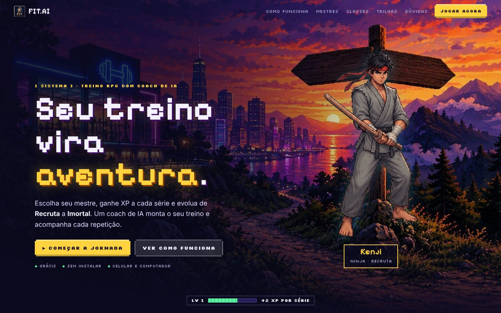
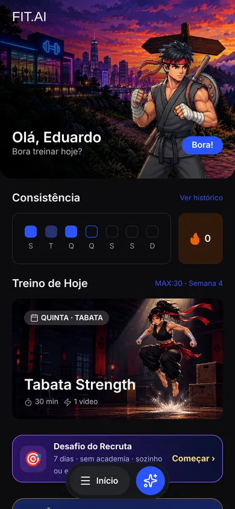
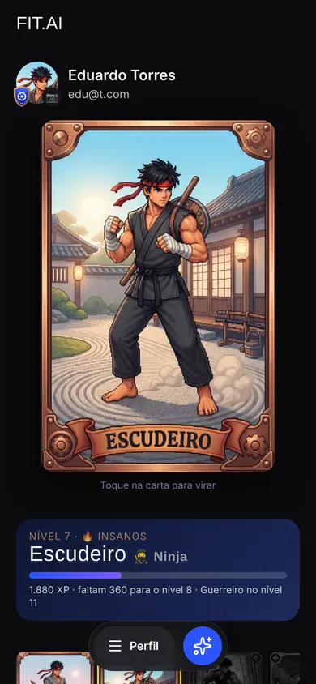
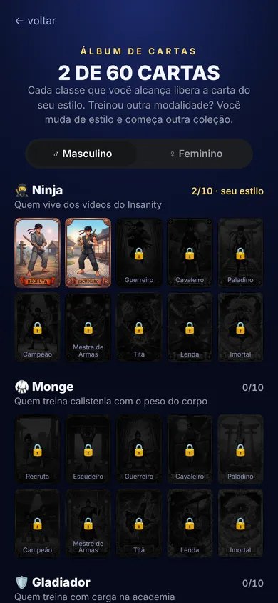
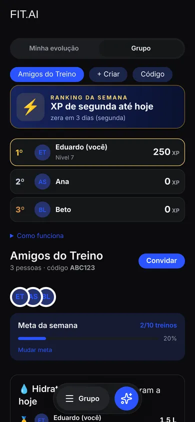

# FIT.AI · seu treino vira aventura



App de treino em formato de **RPG em pixel art**, com um **Coach de IA** (Claude, da Anthropic). Você escolhe seu mestre, ganha XP a cada série e evolui de **Recruta a Imortal**. O Coach monta o treino de Insanity, academia, calistenia, corrida, cross ou híbrido e acompanha cada repetição.

**▶ Ver ao vivo:** https://fitai.eduardotorres-dev.com.br

| Login | Início | Perfil | Treino | Desafio do Recruta | Álbum de cartas | Grupo |
|---|---|---|---|---|---|---|
|  |  |  |  |  |  |  |

## O jogo

- **Seis mestres, seis estilos.** O app olha o que você treina de verdade e te dá um estilo, cada um com seu mestre e sua mestra:
  - 🥷 **Ninja** (Kenji e Yuna): vídeos do Insanity.
  - 🥋 **Monge** (Tenzin e Mei): calistenia.
  - 🛡️ **Gladiador** (Tito e Lívia): academia.
  - 🏹 **Batedor** (Zion e Kaya): corrida.
  - 🪓 **Berserker** (Bjorn e Freya): cross.
  - ⚔️ **Ronin** (Takeshi e Ayame): quem mistura várias modalidades.
- **50 níveis e 10 classes.** A cada 5 níveis o personagem troca de classe, de Recruta a Imortal, e ganha uma carta nova para o álbum. São 60 cartas, nas versões masculina e feminina, e o personagem aparece animado no topo do app.
- **XP a cada série.** O XP aparece na hora em que você anota a série. Também valem treino concluído, recordes, meta de água, semana batida, pesagem semanal e conquistas.
- **Missões do dia:** treino, água, abdômen e desafio da semana, com bônus para quem cumpre todas.
- **Desafio do Recruta:** 7 dias sem academia, em três fases (Despertar, Dungeon e chefe final). Dá para fazer sozinho ou em dupla, com convite e avisos.
- **Ficha de atleta:** quiz de entrada com rank e os atributos FOR, AGI, RES e DIS, que passam a ser calculados pelos treinos reais.
- **Conquistas:** dezenas de selos, do primeiro treino à maratona, passando por Hyrox, subida e treinos do Insanity feitos "até o fim", sem Max Out.

## O Coach de IA

- Monta a ficha numa conversa rápida no chat e revisa o plano toda semana.
- Lê o **print da corrida** (Strava, Garmin, relógio, esteira) e a **foto do quadro do box** de CrossFit.
- Sugere a carga de cada exercício pela última vez e mostra o recorde e a carga máxima estimada (1RM).
- Conhece o seu contexto: nível, missões, pesagens e o que falta para a próxima classe.
- Também atende pelo **bot do Telegram**.

## Comunidade

- **Grupos com código de convite:** ranking de XP da semana, meta coletiva e desafio da semana. O Coach monta esse desafio a partir de um reel.
- **Mural do grupo:** fotos, reações e comentários. Recordes, conquistas e classes novas viram post sozinhos (dá para desligar).
- **Perfil dos amigos:** carta, álbum, conquistas e recordes.

## Como foi feito

- **Front-end:** HTML, CSS e JavaScript puro, sem framework e sem build. É um PWA leve, feito para celular.
- **Artes:** pixel art própria: 120 cartas (6 estilos × 10 classes × 2 versões), personagens animados em WebP, mestres e cenários.
- **Back-end:** Node.js (`server.mjs`) servindo `public/` e as rotas em `api/functions`:
  - `coach`, `corrida`, `wod`, `evolucao`, `desafio`, `dupla`, `hiper`, `agua`, `telegram`, `auth` e `videos`.
  - A chave da Anthropic fica só no servidor, nunca no navegador.
- **Dados:** Supabase (Auth com Google ou e-mail, Postgres com RLS em todas as tabelas, Storage para fotos). O app grava no aparelho e sincroniza quando há conexão.
- **Custos sob controle:** limite diário de perguntas ao Coach por pessoa e geral.
- **Hospedagem:** Hostinger (Node.js), com deploy automático a cada push na branch `deploy-hostinger`.

## Rodar no seu computador

```bash
npm install
cp .env.example .env   # preencha ANTHROPIC_API_KEY e ALLOWED_EMAIL
npm start              # porta em PORT, padrão 3000
```

---

Feito por **Eduardo Torres**: crio sites, apps e automações com IA. Veja mais em [eduardotorres-dev.com.br](https://eduardotorres-dev.com.br).
