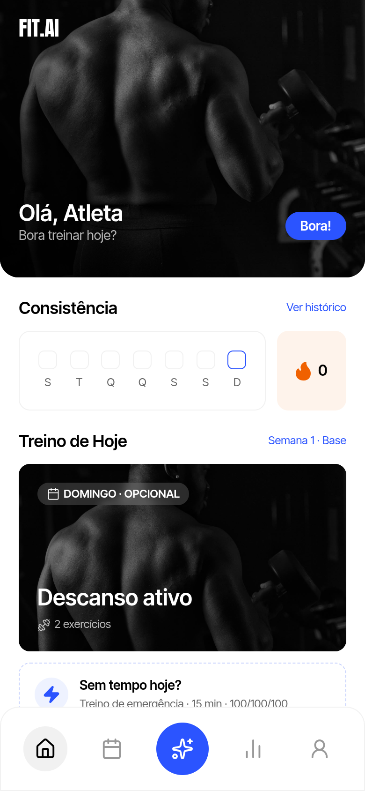
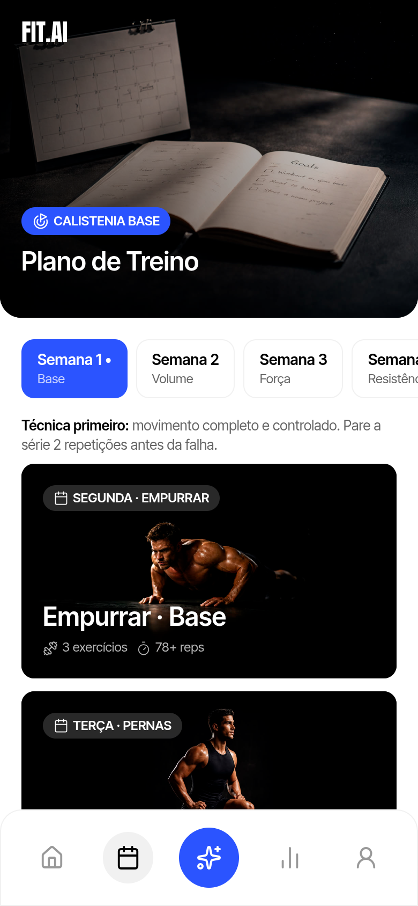
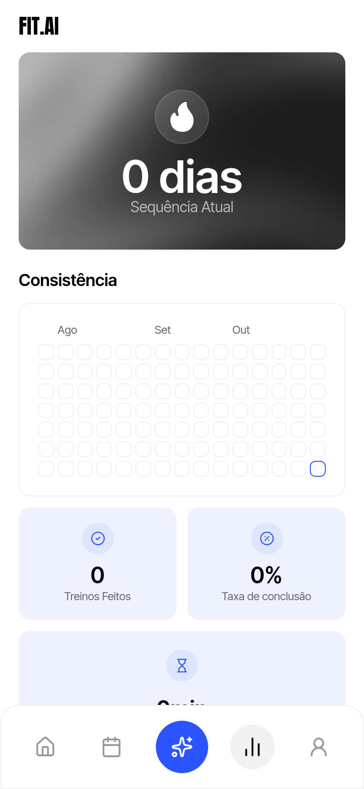
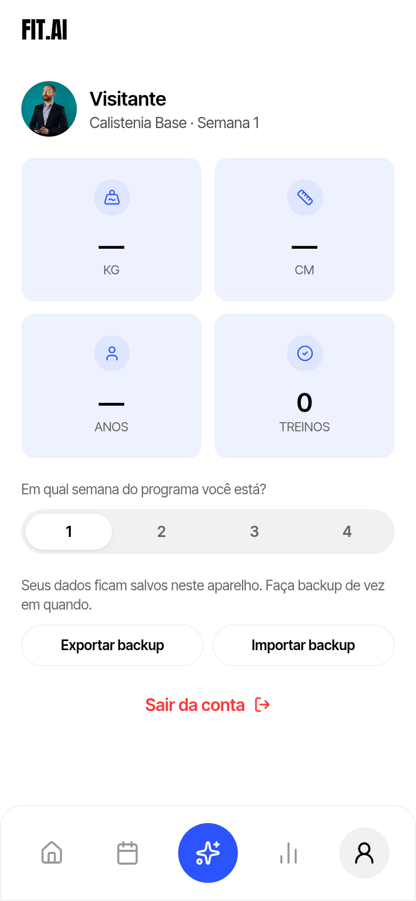
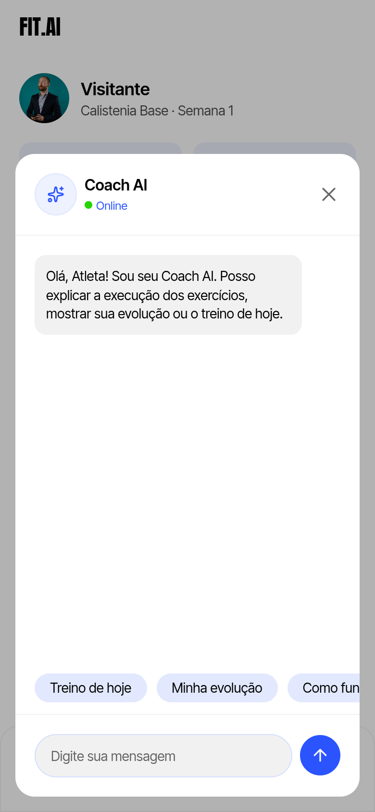

# FIT.AI — app de treino de calistenia com Coach AI

App web mobile para seguir um programa de calistenia, registrar as repetições de cada série e acompanhar a evolução semana a semana, com um **Coach AI** (Claude, da Anthropic) que responde dúvidas de treino em tempo real.

**▶ Ver ao vivo:** https://fitai-eduardo.netlify.app (entre como visitante)

| Login | Início | Plano | Evolução | Perfil | Coach AI |
|---|---|---|---|---|---|
|  |  |  |  |  |  |

## O que ele faz

- **Plano de treino de 4 semanas** com treino do dia, treino de emergência de 15 min e ciclo que recomeça.
- **Registro por série**: anota as repetições e o app sugere a meta da próxima semana (progressão gradual).
- **Evolução**: sequência de dias, mapa de consistência, treinos feitos e taxa de conclusão.
- **Coach AI com IA de verdade**: respostas em streaming, usando o histórico do próprio usuário como contexto.
- **Integração com Strava**: mostra corridas e tiros de 200 m e gera um resumo do treino para postar.
- **Login com e-mail e senha** (hash scrypt + token assinado) ou modo visitante.

## Como foi feito

- **Design**: interface criada no Figma e implementada fiel ao layout, pensada para celular.
- **Front-end**: HTML, CSS e JavaScript puro, sem framework e sem build — leve e rápido.
- **Back-end**: Netlify Functions (Node.js)
  - `/api/coach` conversa com a API do Claude; a chave fica só no servidor, nunca no navegador.
  - `/api/auth` cuida das contas, guardadas no Netlify Blobs.
- **Custos sob controle**: visitantes usam um modelo menor, só sobre treino, com limite de perguntas por dia (por visitante e geral).

## Hospedar fora da Netlify (Hostinger ou qualquer Node.js)

`server.mjs` entrega a pasta `public/` e as rotas `/api/auth` e `/api/coach` com as mesmas funções da Netlify. Contas e limites do Coach ficam em arquivos JSON em `DADOS_DIR` (padrão `~/fitai-dados`, fora da pasta do app).

```bash
npm install
ANTHROPIC_API_KEY=... ALLOWED_EMAIL=voce@exemplo.com npm start   # porta em PORT, padrão 3000
```

## Rodar no seu computador

```bash
npm install
cp .env.example .env   # preencha a chave da Anthropic
npx netlify-cli dev --port 5173 --dir public --functions netlify/functions
```

---

Feito por **Eduardo Torres** — crio sites e apps para negócios. Quer um projeto assim? Me chame no LinkedIn.
